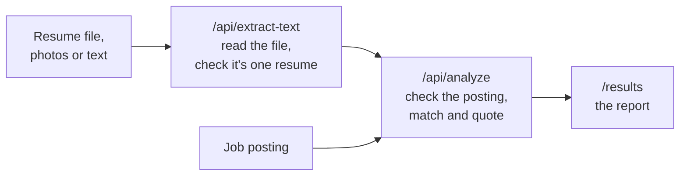

# ResumeFit

[](https://github.com/LuckyJaiswal30/ResumeFit/actions/workflows/ci.yml)

**Compare a resume against a job posting and see which requirements it actually proves.**

**Live:** [resumefit.imlucky.dev](https://resumefit.imlucky.dev)

Most resume checkers match keywords, so a tool listed under "Skills" counts as experience. ResumeFit only counts a requirement when it can quote the line in your resume that demonstrates it. Everything else is reported as a gap.

---

## Contents

- [What you get](#what-you-get)
- [What you can upload](#what-you-can-upload)
- [How it works](#how-it-works)
- [Getting started](#getting-started)
- [Configuration](#configuration)
- [Scripts](#scripts)
- [Project structure](#project-structure)
- [Limits](#limits)
- [Contributing](#contributing)

---

## What you get

| In the report         | What it tells you                                                                                                                      |
| --------------------- | -------------------------------------------------------------------------------------------------------------------------------------- |
| **Verdict**           | Strong, partial or weak match, and how many must-haves you show.                                                                       |
| **Quoted matches**    | Each match carries the exact line from your resume. Quotes are checked against your text, so an invented line never reaches the page.  |
| **Two kinds of gap**  | "Listed, but not shown" (named in your skills, nothing backs it up) is kept apart from "Not there at all", because the fixes differ.   |
| **Fix-first list**    | What to change first, with starter wording for any bullet you need to write.                                                           |
| **Rewrites**          | Sharper versions of weak bullets. A rewrite is dropped if it adds a number or new claims, so scope you never had doesn't creep in.     |
| **Tailoring**         | Where your proof for each top requirement sits, an opening line built from what you can prove, and your skills reordered for the role. |
| **Job title check**   | How your job titles compare with the posting's, since recruiters read titles first.                                                    |
| **Parser report**     | How readable the resume is to applicant-tracking software.                                                                             |
| **Markdown download** | The whole report as a file, since results only live in your browser tab.                                                               |

**No account, no storage.** Files are never saved.

**Try it first.** "See an example" opens a saved analysis without any request. "Try the sample resume and posting" fills in a made-up resume and posting so you can run the real pipeline.

**Works without a model.** With no API key, or if the model call fails, it compares wording only and says so on the page.

---

## What you can upload

| Input                                        | How it's read                                                                                |
| -------------------------------------------- | -------------------------------------------------------------------------------------------- |
| **PDF**, one column or several               | Locally, in the order the PDF was written, so side-by-side columns are never mixed together. |
| **Word** (`.docx`, `.doc`), **ODT**, **RTF** | Locally, keeping page headers, footers, text boxes and list bullets.                         |
| **HTML**, **TXT**, **Markdown**              | Locally.                                                                                     |
| **Photos** of up to five pages               | By Gemini. Large photos are shrunk in the browser first.                                     |
| **Scanned PDFs** and image-only files        | By Gemini, as are PDFs with a scanned page or unreadable text.                               |
| **Pasted text**                              | As is, with "Paste text instead" on the upload page.                                         |

The file type is worked out from the file's contents, so a resume with the wrong extension, or none, still reads.

**One person per upload.** Pages from two people's resumes, or a page that isn't part of a resume, are turned away rather than blended into one report.

---

## How it works



1. **Read.** `POST /api/extract-text` turns the upload into plain text and rejects anything that isn't a resume. Photos and scans go to Gemini, which also reports each page's kind and owner so mixed uploads can be refused. Pasted text skips this step.
2. **Analyze.** `POST /api/analyze` rejects anything that isn't a job posting, then extracts the requirements, matches them to the resume, verifies every quote and scores the result.
3. **Report.** `/results` shows the analysis. It is passed between pages in session storage and never written to a server.

Both inputs are checked before the analysis call, so a wrong document costs no analysis quota and gets a specific reason: an invoice, a recipe, a cover letter, a posting uploaded as the resume, or two people's resumes together. Reading a photo or scan costs one extra model call.

---

## Getting started

You need **Node.js 24** and **[pnpm](https://pnpm.io)**.

```bash
pnpm install
cp .env.example .env.local
pnpm dev
```

Open [http://localhost:3000](http://localhost:3000).

The app runs without an API key, comparing wording only. Add `GEMINI_API_KEY` to `.env.local` for the full review and for reading photos and scans.

---

## Configuration

Set these in `.env.local`. All are optional.

| Variable                                      | Default                 | Purpose                                         |
| --------------------------------------------- | ----------------------- | ----------------------------------------------- |
| `AI_PROVIDER`                                 | `gemini`                | `gemini` or `groq`                              |
| `GEMINI_API_KEY`, `GEMINI_MODEL`              | `gemini-3.5-flash-lite` | Gemini credentials and model, also reads photos |
| `GROQ_API_KEY`, `GROQ_MODEL`                  | `openai/gpt-oss-20b`    | Groq credentials and model                      |
| `AI_TEMPERATURE`                              | `0`                     | Sampling temperature                            |
| `AI_TIMEOUT_MS`                               | `30000`                 | Per-request timeout                             |
| `AI_MAX_PROMPT_CHARS`, `AI_MAX_OUTPUT_TOKENS` | per provider            | Prompt and response size limits                 |
| `AI_CACHE_MINUTES`                            | `60`                    | How long an identical comparison is cached      |
| `AI_BUDGET_PER_MINUTE`, `AI_BUDGET_PER_DAY`   | see below               | Shared request ceiling across all visitors      |
| `UPSTASH_REDIS_REST_URL`, `..._TOKEN`         | unset                   | Shared cache and rate limiting across instances |

Without Redis, caching and rate limiting use in-process memory, which is enough for one instance.

### Providers

Gemini is the default. Groq is a manual fallback, chosen only by setting `AI_PROVIDER=groq` with a key, and it can't read photos or scans. There is no automatic failover: when Gemini fails or its budget is spent, the app falls back to wording-only matching.

| Provider | Free-tier limits                                 | Default budget  |
| -------- | ------------------------------------------------ | --------------- |
| Gemini   | 15 requests/min, 500/day, 250K tokens/min        | 10/min, 400/day |
| Groq     | 30 requests/min, 1K/day, 8K tokens/min, 200K/day | 2/min, 35/day   |

Groq runs out of tokens first: one review costs about 4,850, roughly 40 a day. Raise the budgets on a paid key.

---

## Scripts

| Command             | Does                                                 |
| ------------------- | ---------------------------------------------------- |
| `pnpm dev`          | Start the development server                         |
| `pnpm build`        | Build for production                                 |
| `pnpm start`        | Serve the production build                           |
| `pnpm test`         | Run the test suite (no network calls)                |
| `pnpm lint`         | Lint with ESLint                                     |
| `pnpm format:check` | Check formatting with Prettier (`pnpm format` fixes) |

CI runs format, tests, lint, type-check and build on every push and pull request.

---

## Project structure

| Path            | Contents                                                      |
| --------------- | ------------------------------------------------------------- |
| `app/`          | Pages and the two API routes                                  |
| `components/`   | Shared UI, and `results/` for the report sections             |
| `lib/resume/`   | File reading, resume and posting detection, matching, scoring |
| `lib/ai/`       | Provider config, request client, prompt and response schemas  |
| `lib/security/` | Rate limiting and the Upstash client                          |
| `lib/samples/`  | The made-up sample resume and posting                         |
| `types/`        | Type declarations for packages that ship none                 |
| `tests/`        | `node --test` suite and fixtures                              |

---

## Limits

- **Language:** English resumes only.
- **Size:** files up to 4 MB. PDFs are read up to 30 pages. Password-protected PDFs are refused.
- **Photos:** up to five per resume, sharing the 4 MB. GIF, BMP and AVIF are converted to JPEG in the browser; HEIC and TIFF only in Safari.
- **Pages files:** read only through the PDF preview they carry.
- **Telling people apart:** two people with the same name, or two unnamed pages with similar content, can't be told apart. Text that never goes to the model is refused only when it has two email addresses and repeats the Experience or Education heading.
- **Quota:** free-tier model limits apply, so heavy traffic falls back to wording-only matching.

---

## Contributing

Issues and pull requests are welcome. Before opening a pull request, run:

```bash
pnpm format:check && pnpm test && pnpm lint && pnpm exec tsc --noEmit && pnpm build
```

Please don't attach real resumes to issues. For questions, open an [issue](https://github.com/LuckyJaiswal30/ResumeFit/issues) or email [luckyjaiswal3405@gmail.com](mailto:luckyjaiswal3405@gmail.com).
